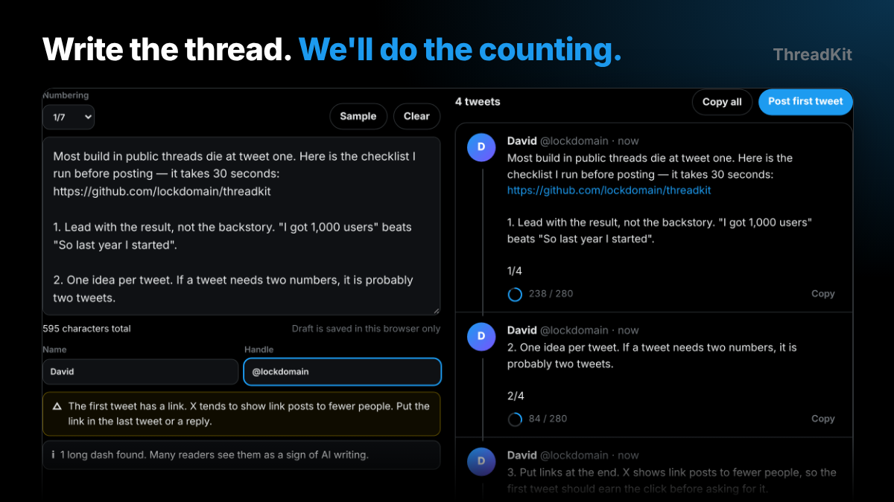

# ThreadKit

**Write the thread. We'll do the counting.**

Paste a long post and get a clean X thread: exact character counts the way X counts them, automatic numbering, a live preview and checks that protect your reach.

**[Try it live](https://lockdomain.github.io/threadkit/)**



## Why

A post that "fits" in your notes app often does not fit on X. Links always cost 23 characters, emoji cost 2, and Chinese, Japanese and Korean characters cost 2 each. Numbering like `12/14` eats space too. ThreadKit counts exactly like X and splits before you hit the wall.

## Features

* Weighted counting that follows the twitter-text v3 rules (URLs 23, emoji 2, CJK 2, limit 280)
* Splits at paragraph ends first, then sentences, never inside a word or a link
* `---` on its own line forces a break
* Numbering as `1/7`, `1/` or none, with space reserved before splitting
* Live preview that looks like the X timeline, with a progress ring per tweet
* Reach checks: link in the first tweet, too many hashtags, hook too short, thread too long, long dashes
* Copy one tweet or the whole thread, or open the first tweet in X
* Draft saved in your browser. No login, no server

## Counting rules

| Content | Cost |
| --- | --- |
| Most Latin text, digits, punctuation | 1 per character |
| Any link (`https://...` or `name.com/...`) | 23 |
| Any emoji, including multi code point ones like 👨‍👩‍👧‍👦 | 2 |
| Chinese, Japanese, Korean and other scripts outside the Latin ranges | 2 per character |

The logic lives in `count.js` and runs in Node as well as the browser.

## Run locally

```
git clone https://github.com/lockdomain/threadkit
cd threadkit
python3 -m http.server
```

## License

MIT
